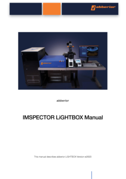

+++
date = '2026-07-15T14:39:42+01:00'
draft = false
title = 'Abberior Mirava Polyscope'
layout = 'simple'
showHero = true
heroStyle = 'background'
+++

### Mirava Polyscope

[abberior’s MIRAVA® POLYSCOPE®](https://abberior.rocks/superresolution-confocal-systems/mirava-polyscope/) combines confocal with STED to extend resolution beyond diffraction-limited imaging.

[Video Overview](https://mediaspace.epfl.ch/media/MIRAVA+Abberior/0_ostaquci) of the system and detailed explanation of the LiGHTBOX software for image acquisition made by Abberior, hosted by EPFL. One hour length.

NB - Our system does NOT have the MiNFLUX module, the MATRIX array detector or the TIMEBOW FLIM option.

[Link](https://github.com/stephenogg/cdn-microscopy/releases/tag/0.0.1) to download the software to install on your own computer. Select either the MacOS (dmg) version or the Windows installer (msi).

Our system specifications:
- IX83 Olympus motorised, inverted stand
- coolLED excitation for sample finding, focusing
- single quadband (DAPI/FITC/Cy3/Cy5) filter for wf imaging
- XYZ motorised stage. 200 micrometer z-range
- 4 excitation laser lines: 405nm, 485nm, 561nm, and 640nm
- Point Scanner with a line frequency of up to 2.6KHz.
- UPLXAPO 60X/1.42 Oil immersion lens for confocal and STED imaging (0.15mm working distance)
- Confocal resolution: ~ 250nm lateral, 750nm Z 
- 775nm STED depletion laser for 2D & 3D STED
	- 2D STED resolution: 30nm
	- 3D STED resolution: 80nm isotropic
- 3 APDs with 65% QE and dark counts < 250Hz
- RAYSHAPE adaptive optics system for all beams (excitation, emission, and depletion). Minimize spherical abberation for deep imaging.
- TRUESHARP deconvolution
- FLSEXPOSURE Adaptive illumination package for highest resolution and live-cell super-resolution imaging at ultra-low light levels (RESCue, DyMIN)

### Sample Preparation and Fluorophore Selection for STED Microscopy

#### Sample Preparation and microscope information PDF document: [Sample Prep Info](samplePrep.pdf)

In STED microscopy, sample preparation is a critical determinant of image quality and achievable spatial resolution. Unlike conventional fluorescence microscopy, where resolution is primarily constrained by diffraction, the performance of STED microscopy is frequently limited by the quality of specimen preparation, labelling efficiency, and fluorophore behaviour. Because STED imaging relies on high-intensity depletion laser irradiation to restrict fluorescence emission to sub-diffraction volumes, samples must exhibit a high signal-to-noise ratio, minimal background fluorescence, and excellent structural preservation. Consequently, fixation protocols should preserve cellular ultrastructure while maintaining antigen accessibility, and labelling strategies should provide sufficient fluorophore density to accurately represent nanoscale biological features. Inadequate fixation, low labelling efficiency, or non-specific staining can introduce artefacts that compromise both image fidelity and effective resolution.

The choice of fluorophore is particularly important in STED microscopy. Not all fluorescent probes are suitable for STED imaging, as the intense depletion beam places substantial demands on fluorophore brightness and photostability. Optimal dyes should exhibit high quantum yield, efficient stimulated emission at the depletion wavelength, and resistance to photobleaching. Organic fluorophores such as the Abberior STAR, ATTO, and Alexa Fluor dye families are commonly employed because they combine high brightness with favourable STED performance. Fluorophore selection must also consider spectral compatibility with the excitation and depletion lasers available on the microscope, as mismatches can reduce depletion efficiency and limit resolution gains. Furthermore, the effective resolution achieved in a STED image depends not only on the microscope optics but also on the size and distribution of the fluorescent label itself. Large probes or sparse labelling can become the dominant limiting factor when imaging biological structures at nanometre scales. Therefore, careful optimization of fluorophore choice, labelling density, fixation conditions, and mounting media is essential to fully exploit the super-resolution capabilities of STED microscopy.

> In STED microscopy, image quality is often limited less by the optical system than by the quality of sample preparation and fluorophore selection. Even the highest-performing STED instrument cannot recover structural information that has been lost through poor preservation, insufficient labelling, or photobleaching.

### Tutorial

Click on the thumbnail for a copy of the complete imaging manual.

#### Step by Step --- Quickstart --- TL;DR



{}

- Turn on the computer (It's on already).
- Turn on the IX-83 stand controller and the coolLED controller (1 & 2)
- Turn on the Microscope Stand Touch Panel (3) - wait until it's completely initialised.
- Login to the computer with your King's credentials.
- Open the LiGHTBOX Software.
- Starting the software will power up the complete system. The STED laser will begin to warm up.
- Allow 30m warmup prior to imaging.
- After starting the LiGHTBOX software, wait until the ‘Welcome’ screen of the LiGHTBOX appears.
- In the right, upper corner of the ‘Welcome’ screen, a system status indicator is displayed.
- Hovering over the system status indicator brings up a list of all modules and their specific status info.

{}

{}

- If you're the first user of the day, you must perform an auto-alignment.
- Make sure you have turned on the microscope and allowed the STED laser to warm up for > 30m
- Obtain the autoalignment slide from Steve.
- Mount the autoalignment slide on the system. 
- From the "Measurement" menu, choose 'Auto alignment'.
- Let the alignment complete. It should take 2 to 5 minutes.

{}

{}

- Place your sample on the stage.
- Select "FL" on the microscope touch panel.
- Switch the LED **ON**
- Select appropriate wavelength for LED excitation.
- Alternatively, select "BF" on the microscope touch panel for Brightfield imaging.
- Select the "DIA" pane on the touch panel to control the lamp brightness.
- Focus --- Clockwise moves the lens down, away from your sample.

{}

{}

- X/Y Stage Control: top dial moves X, bottom dial moves Y.  Third dial does nothing.
- +/- change the speed of the stage
- Press the green LED on the front of the stage (yes, it's also a button) to release the stage for manual movement.
- Press the green LED again to lock the stage and transfer control back to the stage controller.

{}

{}

- From the "Welcome" hamburger menu, select "change default save location".
- Initially, the default is "C:\User\abberior\Documents\Pictures"
- Select the D: drive and sub-folder with your name. (Create your folder first, if needed.)

{}

{}

- From the "Welcome" menu, choose **'New Sample'**.
- Select dyes from the list that are in your sample. Drag and drop them from the left to the right side of the screen.
- Optional, enter a sample name in the **'Sample Name'** field.
- Optional, enter details about each dye.
- Optional, enter experimental details in the **'Notes'** section.
- Select a colormap for each dye, or select a preset group by clicking on **'Single Color'** or **'Overlay color'** text. 
- Press the **'START'** button

{}

{}

- Click **'PREVIEW'** to continuously scan the currently selected sample position.
- During the preview scan, the sample position can be adjusted by clicking and dragging the image in the display, or by moving the stage with the stage controller
- During the preview scan, the sample focus can be adjusted by adjusting the focus wheel on the Z-Drive (NB - this moves the lens), or by using the mouse wheel when the cursor is placed over the image (This moves the z-piezo stage).
- Clicking **'PREVIEW'** again stops the scan at the next complete image, clicking **'STOP'** stops the scan immediately.

{}

{}

- To acquire a larger overview scan, click **‘EXPLORE’**. 
- This opens the ‘NEW OVERVIEW’ dialogue where the desired overview size can be defined by specifying the number of Fields of View (FOVs), to be acquired.
- Clicking **'NEW OVERVIEW'** will start a spiral scan of the requestsed number of FOVs starting at the current position.
> [!TIP] To facilitate accurate stitching of acquired tiled images, an overlap of 10% is recommended. 

{}

{}

- All overviews and images acquired in one session will be listed in an **‘Image Tree View’** on the left side of the screen.
- When the first overview of a sample is acquired, it is automatically placed in 'Folder 1'.
- To create a new folder, click the ‘plus’ icon in the lower-right corner in the Tree View and select 'New Folder' from the drop-down menu.
- Overviews and images can be moved between folders at any time by clicking and holding the desired item, then dragging and dropping it into the target folder.
- To rename a folder, double-click its default name (e.g. Folder 1) and enter the desired name.
- For further organization, acquired overviews and images can also be sorted or filtered.
- To access the sorting and filtering options, click the sorting or funnel icon above the Tree View.
- Delete an image by selecting it in the image tree, choosing the three dots and selecting Delete or by pressing the <kbd>delete</kbd> key.
> [!CAUTION] After selecting **Delete**, the images are deleted immediately and irretrievably.

{}

{}

- Images in the current session can be saved by selecting the sample name (e.g. 'Sample 1'), clicking the three-dot menu and selecting 'Save as Copy'.
- This opens a Windows file explorer where the desired destination folder can be selected. Click 'SAVE' to store all images in the tree as an *'.obf'* file.
> [!NOTE]+ Opening .obf Files in Fiji:
> drag and drop your *.obf* file directly into the Fiji window. The built-in Bio-Formats plugin will automatically recognise the format.
- Alternatively, selecting **'New Sample'** saves the current sample into the default save location and returns the user to the dye selection menu.

{}

{}

- Regions of interest (ROIs) can be selected in overviews and images to acquire high-quality/high-resolution data of the regions.
- To select an ROI, select the **'Draw image region'** button in the [Tools menu](ToolsMenu.png) right to the Acquisition menu.
- The Tools Menu is located next to the Scan menu. The active tool is displayed in orange.
- When the ROI tool is selected, an ROI can be drawn in the overview or any previous image by clicking and dragging with the mouse cursor.
- Hovering over one of the corners of the ROI will activate a small orange arc. Selecting the arc allows rotation of the ROI.
> [!TIP] If the ROI exceeds the maximum field of view, a tiled image is automatically acquired. This is indicated by faint lines that split up the ROI into the number of individual tiles that will be acquired.
- Clicking the **'PREVIEW'** button in the Acquisition window results in continuous scanning of the ROI.
- Clicking the **'ACQUIRE'** button starts a single scan of the entire ROI.

{}





{}

- General settings for image acquisition can be controlled via the Acquisition drop-down menu, located in [‘SCANNING’ tab](Scan.png) in the Measurement window.
- Opening the 'Acquisition' menu reveals its tab-structure, including the ['GENERAL' tab](General.png) which allows general settings for confocal and STED imaging to be defined.
- Prevent Detector Saturation:
	-The APDs used to detect photons saturate if the photon count rises to more than 10,000,000/second.
	- Set % Excitation for each channel so that the max counts in the image (displayed above the image) divided by the pixel dwell time is < 10,000,000. E.g. if pixel dwell time is 5µs, the counts in each channel should not exceed 50 because: \(\dfrac{50}{5 X 10^{-6}} = 10,000,000\)
	- Use the mouse scroll wheel to increase/decrease the laser power by 1% increments. The <kbd>alt</kbd> modifier while scrolling changes the increment to 0.1%. <kbd>Shift</kbd> changes it to 10%.
	- To increase the signal, use more line accumulations.
- Set the pixel size according to your requirements. For confocal imaging, our lens requires 80nm pixels to achieve best (diffraction-limited) resolution. 

{}

{}

- A STED image can be added by selecting the ‘plus’ symbol in the Acquisition menu below the STED heading.
- A STED channel (indicated by the donut symbol) will open below the confocal channel. 

{}

