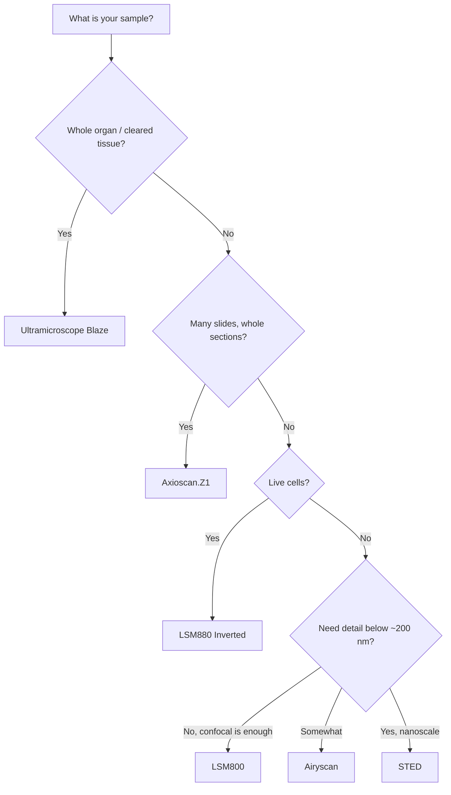

+++
title = "Which Microscope Should I Use When?"
layout = "simple"
+++

## Start here

Choose the system by your **question and sample**, not by the most advanced instrument. The simplest system that answers your question gives the best data and is easiest to book.

Not sure? Email [the facility manager](mailto:stephen.ogg@kcl.ac.uk) with a short description of your sample, labels and question **before** you request training.

## Quick chooser

| My sample / question | Best system | Notes |
|---|---|---|
| Whole organisms, embryos, dissections, gels, quick look at fluorescence | [Discovery.V20](/systems/discovery) | Low magnification (7.5x-150x), stereo viewing. Not for subcellular detail. |
| Many slides (brightfield H&E, IHC, or fluorescence); whole sections; consistent, unattended scanning | [Axioscan.Z1](/systems/axioscanz1) | Widefield, up to 40x. Not confocal, so no optical sectioning. |
| Fixed cells or tissue; multicolour; Z-stacks; colocalisation | [LSM800](/systems/lsm800-histology) (Histology or FISH) | Standard confocal with optional Airyscan. |
| Zebrafish or larger fixed samples on slides or dishes | [LSM800 FISH](/systems/lsm800-fish) | Fixed-stage upright stand. |
| Live cells, time-lapse, incubation (temperature, CO2) | [LSM880 Inverted](/systems/lsm880-inverted) | Inverted stand; environmental control. |
| Resolution better than a normal confocal (about 120-140 nm) | LSM880 with Airyscan, or LSM800 Airyscan | Needs thin, bright samples and good sampling. (all Zeiss confocals have the Airyscan detector). |
| Features smaller than about 100 nm (nanoscale structure) | [Mirava Polyscope (STED)](/systems/sted) | Fixed, well-labelled samples; STED-compatible dyes; training is longer. |
| Large, cleared whole organs or whole mouse bodies | [Ultramicroscope Blaze](/systems/ultramicroscope-blaze) | Light sheet; cellular resolution; requires tissue clearing. |
| Simple fluorescence or brightfield checks of cultures | [EVOS M3000](/systems/evos-m3000) | Benchtop widefield. (located in the Hodgkin TC suite) |
| Needs an instrument we don't have | [Non-centre systems](/systems/non-centre-systems) | Access arranged by email. |

## Resolution at a glance

Approximate best-case lateral resolution. Your result depends on the sample, labels, objective and settings.

| Method | Lateral resolution (approx.) | Optical sectioning |
|---|---|---|
| Stereo / widefield (Discovery, EVOS, Axioscan) | microns | No |
| Confocal (LSM800, LSM880) | about 200-250 nm | Yes |
| Airyscan | about 120-140 nm | Yes |
| STED (Mirava) | about 30-80 nm (vendor best case) | Yes |
| Light sheet (Blaze) | about 0.6-3 µm, depending on lens | Yes (the sheet) |

Higher resolution costs more: more light on the sample (bleaching), slower imaging, stricter sample preparation, and more training.

## Which modality for which question?

## Compare the systems

| System | Stand | Type | Live cells | Typical use | Training |
|---|---|---|---|---|---|
| Discovery.V20 | Stereo | Widefield/stereo | No (short checks only) | Macro samples | Short |
| EVOS M3000 | Inverted | Widefield | No | Quick checks | Short |
| Axioscan.Z1 | Slide scanner | Widefield | No | Slide libraries | Medium (scan profiles take practice) |
| LSM800 (FISH) | Upright | Confocal + Airyscan | No (fixed samples) | Fish, thick fixed samples | Medium |
| LSM800 (Histology) | Upright | Confocal + Airyscan | No (fixed samples) | Sections, cells | Medium |
| LSM880 Inverted | Inverted | Confocal [+ Airyscan] | Yes | Live imaging, cells in dishes | Medium to long |
| LSM880 Upright | Upright | Confocal [+ Airyscan] | Yes | Fixed & Live Zebrafish | Medium |
| Mirava Polyscope | Inverted | Confocal + STED | Fixed (live by arrangement) | Nanoscale structure | Long |
| Ultramicroscope Blaze | Light sheet | Light sheet | No (cleared samples) | Whole organs | Long; involves chemicals |

## Before you ask for training

- Have samples ready (training is done on them).
- Know your coverslip type (see [Coverslip Thickness](/protocols/coverslip-thickness)).
- Know your fluorophores and your planned controls.
- Read the [Laser and Chemical Safety](/training/safety) page.

## Common mistakes when choosing

- Choosing STED when confocal or Airyscan would answer the question.
- Using a slide-mounted sample (thick, mismatched medium) on a high-NA objective.
- Planning live imaging on a system without environmental control.
- Choosing a system by resolution alone and ignoring sample thickness, bleaching and imaging time.
- Requesting training with no samples.
